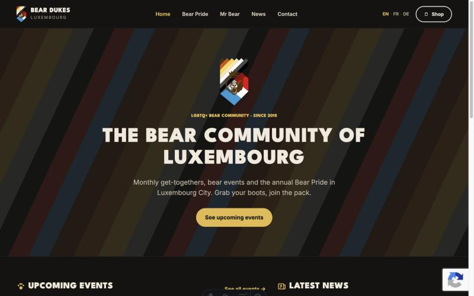
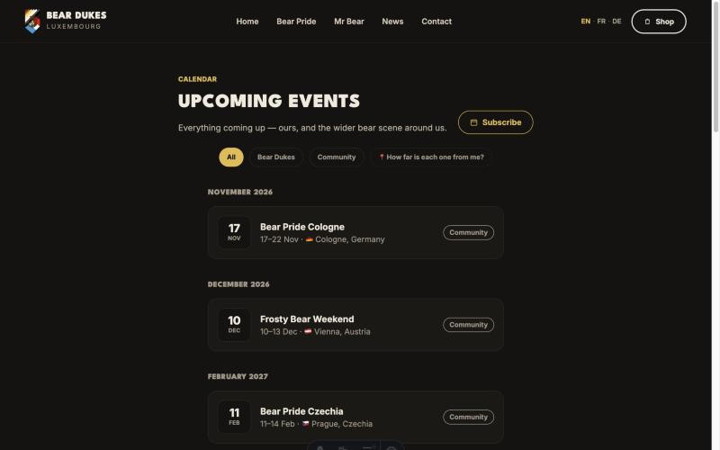
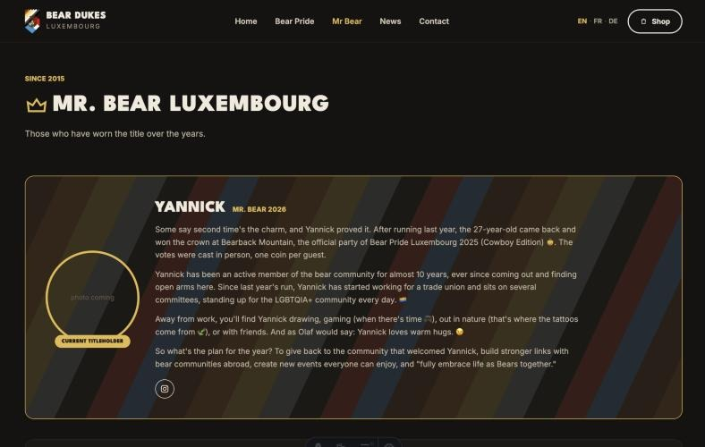

Yeah, it's been quiet. Almost two years without a post. Bears hibernate though, so we'll say that's what we were doing. We're waking up now and a few things are getting put back in motion. You'll see more of it over the coming weeks. First up: the site.

## A new bears.lu

The old site was starting to show its age. Updating it was a pain, it wasn't easy to maintain, and a few things people kept asking us for just weren't possible with how it was built. So we rebuilt it from scratch instead of patching it up: faster, closer to our actual branding, and a lot easier for us to update ourselves.

## An actual calendar

Events used to live wherever: Facebook, word of mouth at a party, whatever. There's now a proper [/calendar](/calendar) page with everything in one place, ours and other bear events happening around Europe, with filters. If you let it use your location it'll also tell you how far each one is.

You can subscribe to it from your phone or computer's calendar app too. Hit "Subscribe" once and it updates itself from then on.

## Every Mister Bear, finally in one place

Every titleholder since José in 2015 has their own page now on [/mr-bear](/mr-bear), with the current one front and center. Small thing, but it bugged us that ten years of Misters were sitting on a page nobody could find anymore.

## Other bits

- Comments work again on articles.
- There's a Share button on articles now that just opens your phone's normal share sheet.
- The news feed is still at the same address as before, so nothing breaks if you were subscribed.
- Even the favicon is our bear now instead of whatever default placeholder it was before.

## We could use some help

Keeping the calendar up to date and writing stuff for the news section takes time, and it's mostly been one or two of us doing it between everything else. If you'd be up for helping out with either — adding events as you hear about them, or writing the odd post — [get in touch](/contact). Doesn't have to be a big commitment.

That's the first thing. More to come. If you spot something broken on the new site, [tell us](/contact).
